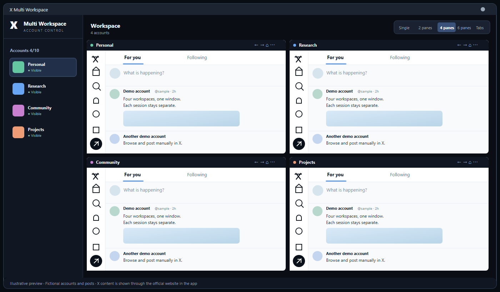

# Xnarabi

English | [日本語](README.md)

I wanted to keep several X accounts side by side, so I made this free Windows app. Xnarabi opens up to 10 X screens in one window. Each screen shows the official X website and has its own login session.

**Xnarabi is an unofficial app. It is not affiliated with or endorsed by X or X Corp.**

[Download the installer or portable app](https://github.com/devtk-core/xnarabi/releases/latest) · Windows 11 x64

[English user manual](docs/USER_MANUAL.en.md) · [Japanese manual (Dennou Tech)](https://www.dennou.tech/software/xnarabi/manual/)

*Illustrative preview with fictional accounts and posts. Your workspaces show the official X website.*

## What you can do

- Keep up to 10 account workspaces and view 1, 2, 4, 6, or 10 screens at once, or use tabs.
- Give each workspace a name and color, then jump between them from the sidebar or with Ctrl+1–9 (Ctrl+0 for the tenth).
- Drag sidebar items to reorder them, or drag a screen's top bar onto another to swap their positions.
- Open Home, Notifications, Profile, or Compose in any workspace. Post and attach media manually in X.
- Maximize a screen when you need room; suspend a workspace when you want to free memory.
- Use the app in English or Japanese. X's own language follows your X settings.
- Check for updates on demand. The app opens the GitHub download page if a new version is available; it does not install updates automatically.

## Start using it

1. Download and launch the [installer or portable app](https://github.com/devtk-core/xnarabi/releases/latest).
2. Add a workspace and sign in through the X page it opens.
3. Choose a layout at the top of the window.

Each workspace has separate browser storage, and valid X sessions can persist after restarting. The app uses neither the X API nor its own server, and it does not store passwords separately.

**Memory:** Each loaded X screen uses memory much like a browser tab. In one eight-screen test, the whole app used about 1.4 GB. Usage varies with images, video, and browsing. Suspending a workspace can free memory, but unsent text in that view may be lost.

For setup, builds, security details, and known limitations, see the [technical guide](docs/TECHNICAL.md).

The [English user manual](docs/USER_MANUAL.en.md) and [Japanese user manual](docs/USER_MANUAL.ja.md) cover installation, controls, updates, and troubleshooting.

OpenAI Codex is used in the development of this app.
