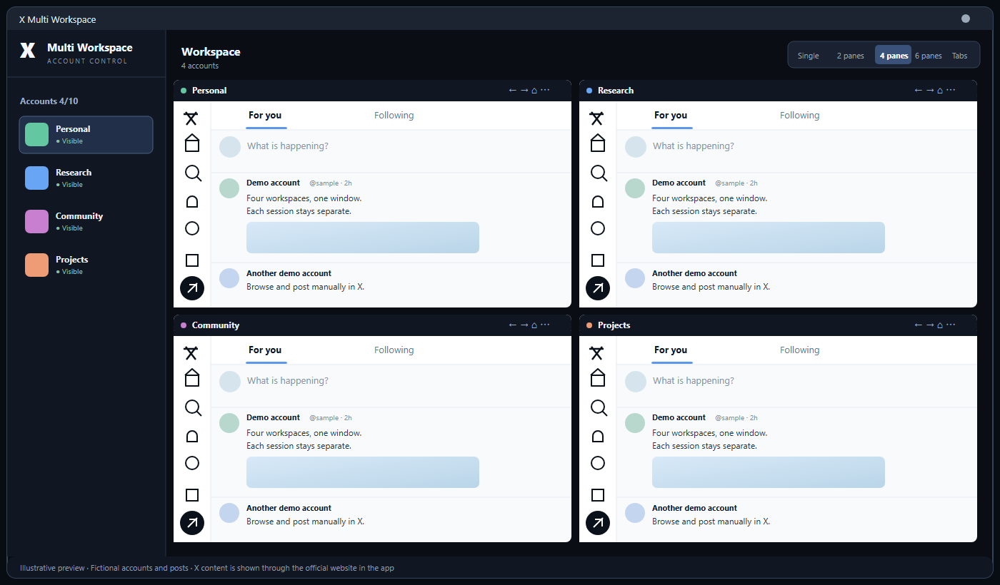

# X Multi Workspace


English | [日本語](README.ja.md)

X Multi Workspace is a Windows desktop app for manually managing up to 10 X accounts in one window. Each account workspace displays the official X website in its own persistent Chromium session. The app does not use the X API or an external server.

[Download the Windows installer or portable version](https://github.com/devtk-core/x-multi-workspace/releases/latest)



*Illustrative preview using fictional accounts and posts. The app displays the official X website; your X content will differ.*

## Features

- Single view, 2, 4, 6, or 10 panes, and tabs
- Separate cookies and local storage for every workspace
- Per-workspace name, optional X handle, color, order, and zoom
- Home, notifications, profile, compose, reload, back, forward, and maximize controls
- Manual suspend and resume, with sessions retained
- English and Japanese app UI; the initial language follows the Windows locale and can be changed with the `EN` / `日本語` button

The language switch applies to the app's controls. The official X website uses its own language settings. Switching the app language does not reload X views or sign you out.

## Requirements

- Windows 11 x64
- Node.js 22 LTS or later and npm 10 or later for development
- Internet access for installing dependencies and using X

## Development

```powershell
npm install
npm run dev
```

The development command starts Vite, the TypeScript watcher, and Electron. It serves the local app UI at `http://127.0.0.1:5173`.

## Checks and Windows builds

```powershell
npm run typecheck
npm test
npm run dist:win
```

The build produces an NSIS installer and a portable executable in `outputs/`. They are unsigned; configure code signing before distributing them broadly.

The Windows application icon is generated from the original vector artwork at `build/icon.svg`.

## Getting started

1. Add a workspace and set its name, optional X handle, color, and zoom.
2. Sign in manually in the official X page shown in that workspace. Use a different account in each workspace if needed.
3. Choose a layout at the top. In a split layout, selecting a workspace in the sidebar moves to the page containing it.
4. Use each pane's controls to navigate or open the compose page. Write posts, paste text, and attach media manually in X.
5. Open a workspace's settings to reorder, suspend, resume, or remove it.

Shortcuts: `Ctrl+1`–`Ctrl+9` select workspaces 1–9, `Ctrl+0` selects workspace 10, `Ctrl+R` reloads the selected view, `Ctrl+Shift+P` opens its compose page, and `Esc` leaves maximized view.

## Storage and memory

- Settings, including language, layout, window position, and workspace details, are saved locally in Electron's `userData/settings.json`.
- Each workspace uses an Electron `persist:xmw-<UUID>` session. Electron manages its cookies and local storage. The app does not collect or save passwords or authentication tokens separately.
- Hidden views load only when first shown. Once loaded, they stay alive when switching layouts to preserve the current page and drafts. Reducing the pane count therefore does not immediately reduce memory usage.
- In one eight-pane test, the entire app used about 1.4 GB. An X view may use roughly 100–200 MB, but this varies widely with content and video. The eight-pane total includes shared app processes and is not a fixed per-pane requirement.
- Manually suspending a workspace closes its WebContents while retaining the session. Unsaved posts or form input may be lost, so the app asks before suspending. Resume opens the last saved X URL.
- When removing a workspace, the app asks whether to clear its session data as well.

## Security and limitations

- Remote X views disable Node integration and enable context isolation, sandboxing, and web security. IPC accepts input only from the local app UI and validates it.
- Non-X links open in the system browser. X popups open in the same workspace. Sign-in through an external identity provider or X features that require a popup may not work.
- Camera, microphone, and screen-sharing permissions are denied. Attach images or videos through X's own file picker.
- Chromium's WebRTC mDNS responder is disabled, and X views restrict WebRTC to proxied UDP or TCP, to avoid the Windows Firewall inbound-access prompt observed on first launch. The v1.1.3 release candidate did not show the prompt on the tested Windows 11 PC. This cannot guarantee the same result on every PC. Peer-to-peer features such as Spaces may be limited.
- The portable executable extracts to a temporary folder on each launch. A new executable path can cause Windows to treat it as a new app for firewall rules. The app does not require inbound network access for normal X browsing and posting.
- Ten panes can become cramped at lower resolutions and increase Chromium memory use. X may switch to a mobile layout in narrow panes.
- If X changes URLs such as `/compose/post`, the corresponding navigation button may need updating. The app does not bypass X limits, authentication, or CAPTCHAs, and does not automate posting or account actions.
- Actual X sign-in, session persistence after sign-in, posting, paste, and attachments require user acceptance testing. Automated tests do not operate X accounts.

## Suggested acceptance checks

1. Sign in to different X accounts in two workspaces and confirm that they remain separate.
2. Restart the app and confirm that both valid X sessions remain signed in.
3. Switch among single, split, and tab layouts and confirm that current pages and drafts remain where possible.
4. In each workspace, manually test posting, text paste, and image or video attachments.
5. Test suspend, resume, and optional session deletion.

See [README.ja.md](README.ja.md) for the Japanese guide.
